Markdown
# BÁO CÁO BÀI TẬP / ĐỒ ÁN

## THÔNG TIN SINH VIÊN
- **Họ và tên:** Nguyễn Trọng Hiếu
- **Mã số sinh viên:** 24810320307
- **Lớp:** D19QTANM1
- **Tên môn học:** Lập trình C# / Windows Forms
- **Tên bài tập:** BÀI TẬP SÁNG NGÀY 10 THÁNG 10 NĂM 2026
- **Ngày nộp:** 10/10/2026
- ## KẾT QUẢ THỰC HÀNH

### 1. Ảnh màn hình Giao diện chính
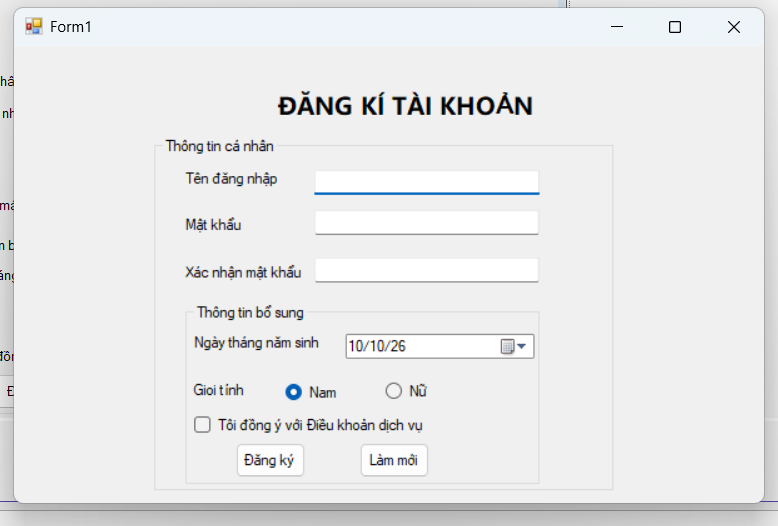

### 2. Ảnh màn hình Chức năng thực thi / Kết quả
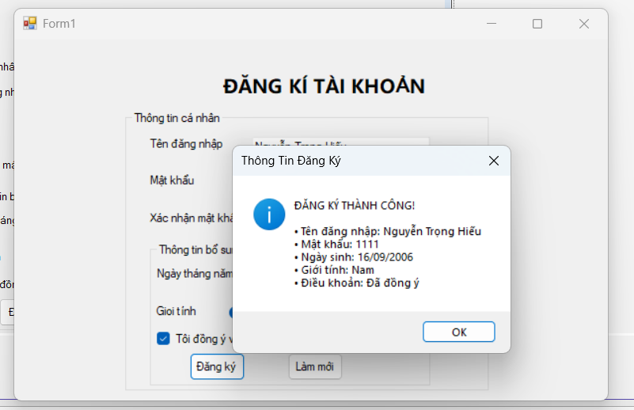

### 3. Ảnh màn hình Kiểm tra lỗi (Validation)
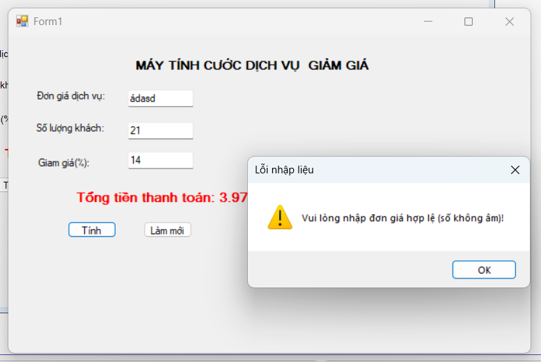

### 1. Ảnh màn hình Giao diện chính
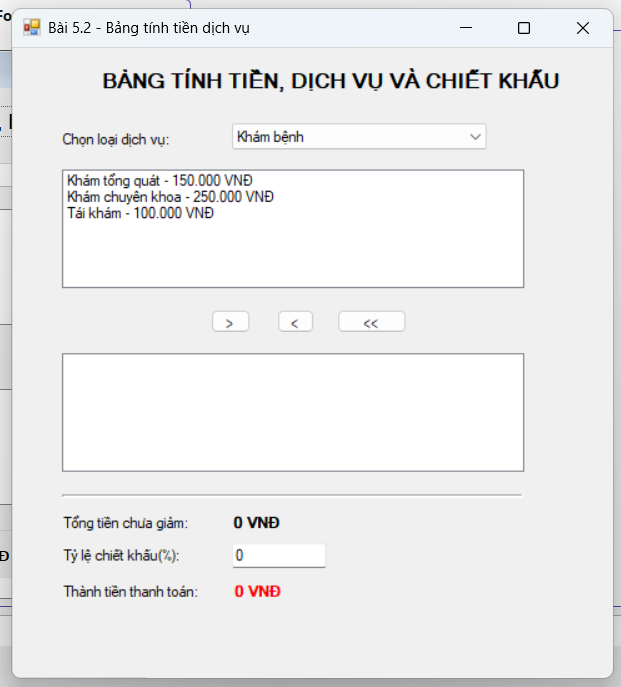

### 2. Ảnh màn hình Chức năng thực thi / Kết quả
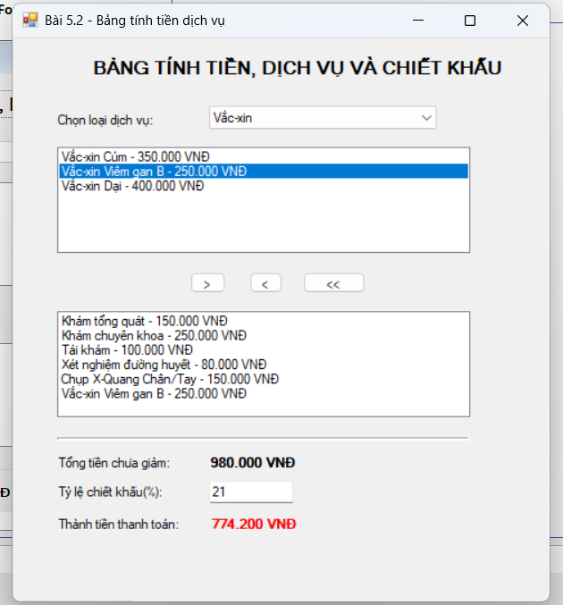

### 1. Ảnh màn hình Giao diện chính
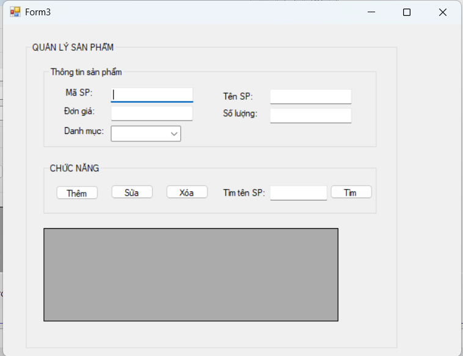

### 2. Ảnh màn hình Chức năng thực thi / Kết quả
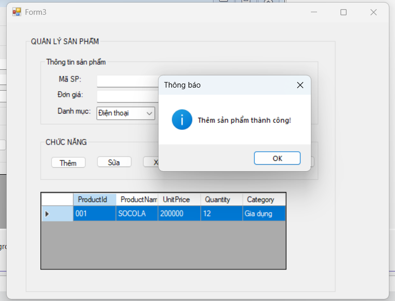

### 3. Ảnh màn hình Kiểm tra lỗi (Validation)
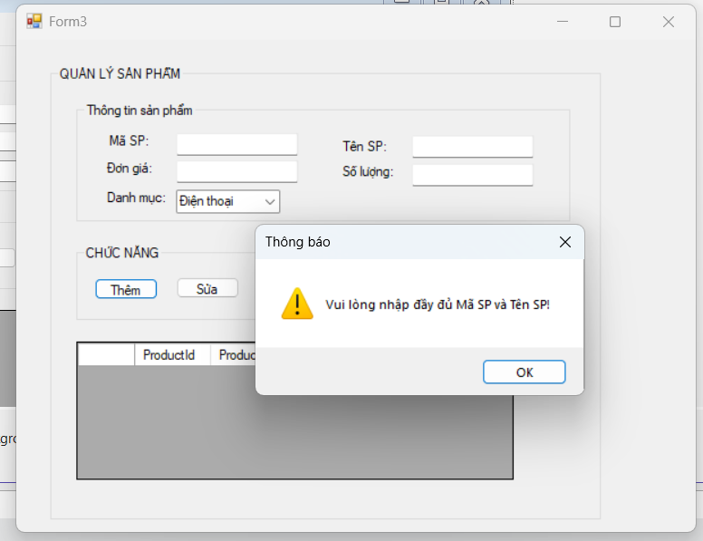

### 1. Ảnh màn hình Giao diện chính
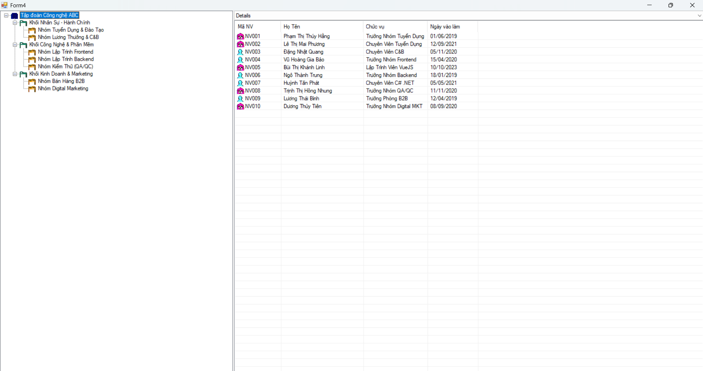

### 2. Ảnh màn hình Chức năng thực thi / Kết quả 
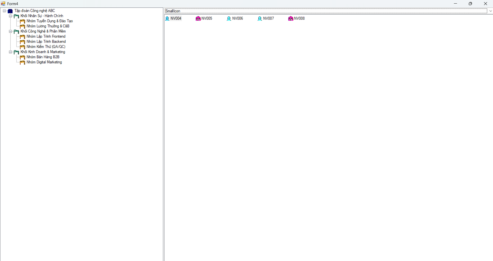

### 2. Ảnh màn hình Chức năng thực thi / Kết quả
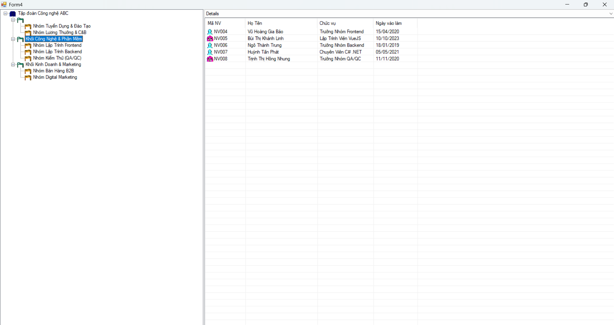